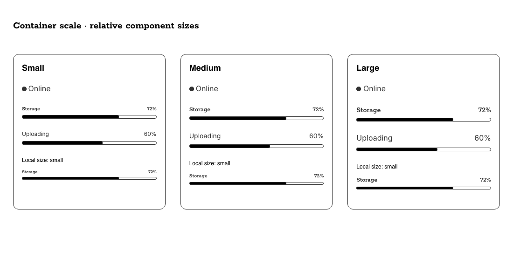

# Container scale implementation evidence

Owner-authorized follow-up to PR #329, based on `7ecac988333944eba1ab219c24fadbe3439afb2e`. The agreed context scales font size, line height, spacing and radii while keeping local sizes relative. Implementation and acceptance scope are recorded in `execution-contract.json`; consumer usage is in [Container scaling](../../container-scale.md).

## Implemented contract

`data-scale="small|medium|large"` belongs to a container. Descendants inherit its context; a nearer recognized container replaces it. A component's local size multiplies the chosen context. Unrecognized values do not reset inheritance. No context means medium. The first adopters are StatusLight, Meter and ProgressBar; other existing components are not silently migrated.

The normal CSS build derives unitless factors from existing Core Font/Size xs, sm and md divided by sm. Source anchors currently resolve to 12, 14 and 16; the resulting ratios are 12/14, 1 and 16/14. There are no new Figma tokens, invented variable IDs, duplicated numeric scale decisions or shared semantic changes. Eight existing StatusLight/Meter typography slots are re-aliased to the corresponding existing Semantic Scale roles. Historical small-specific typography slots remain exported but no longer independently control local small typography. Track/indicator geometry keeps its old local-size behavior, and container scale does not multiply geometry or border width.

Human: the container and local size remain independent choices. Agent: deterministic source derivation and bounded tests expose resolution and adoption limits. System: CSS inheritance performs updates without rebuilding DOM or adding JavaScript runtime providers. Existing fluid typography, Brand and Scheme remain separate concerns.

The original initial-component acceptance evidence remains historical. This record owns the added container behavior. Live Figma parity and active Code Connect remain BLOCKED; no shared governance pack or Vault decision was modified and no merge/release is included.

## Verification

- `CI=1 npm run ci:check`: PASS, 198 unit tests and 20 Chromium tests. Includes lint, unit tests, build, naming/docs/token/asset/rule checks and browser tests.
- `npm run pack:check`: PASS, including the generated context in the Core bundle.
- Container tests verify all four scaled properties, fixed geometry/borders, relative local size, sibling isolation, nearest-context replacement, explicit medium reset, unknown-context inheritance and changes without rerendering.
- Root font-size changes remain proportional. Static macros scale without Custom Element JavaScript.
- Playground control checks exercise Container scale separately from local Size. Nunjucks and WC generators retain the wrapper and zero values.
- Documentation DOM checks: all existing sections, API/examples/tokens/links, hero switches and mobile overflow remain correct.
- The comparison screenshot was visually inspected. It shows three contexts and a locally small Meter within each.

Local validation used Node 22.23.2 and the existing installed dependencies. Fresh-install Node 20/22 evidence is supplied by GitHub CI. Generated `dist/` files were produced only by the normal build, not edited directly.

## Integration with updated main

Main advanced to `cc85087` (#330) during implementation and independently added a source-element docs passthrough. The PR merge check demonstrated a duplicate destination when combined with this branch's earlier dist-element passthrough. Main was integrated into the feature branch and only the duplicate dist registration was removed. See `integration-repair.json` for the failing GitHub evidence and bounded repair. The resulting combined state passed the full 198-unit/20-browser gate, package dry-run and documentation checks.
