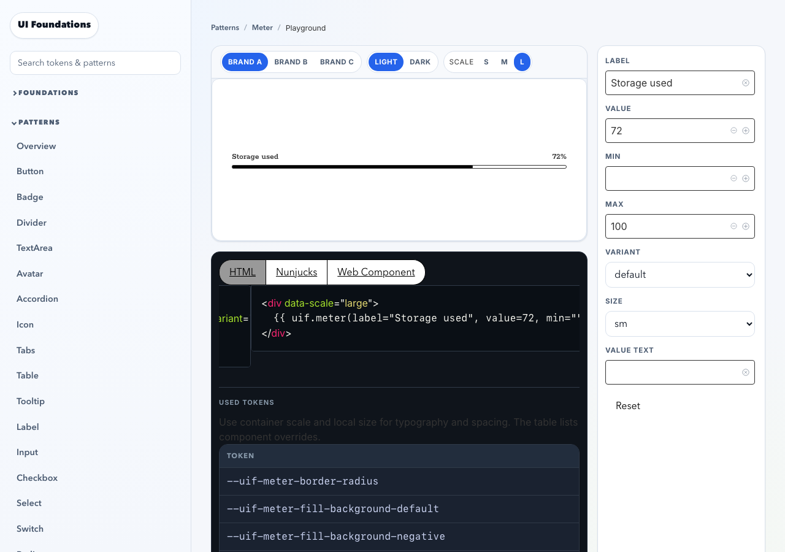
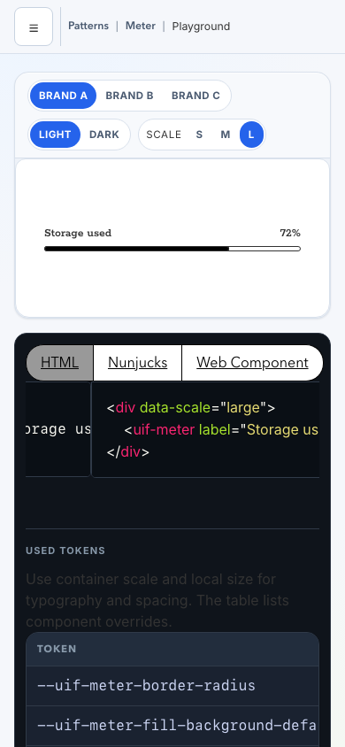

# Preview scale switch

Owner-requested follow-up: expose container scaling beside the existing theme switch, and publish the changes/create the replacement PR as `uif-intelligence`. Runtime behavior remains bounded to StatusLight, Meter and ProgressBar. The scale UI is enabled only for supported previews; the shared preview macro accepts an explicit opt-in.

The preview header now contains Scale S/M/L next to Light/Dark. Static examples apply data-scale to their preview container. Playground examples use the existing form state, URL and code generators; their scale select is retained as a hidden native state control so initial URL values and Reset remain deterministic. Local Size stays visible in the properties panel. A local playground state event synchronizes pressed buttons after initialization, re-render and reset. Brand/scheme token snapshots exclude inherited context/local scale variables so they cannot freeze the chosen scale.

The controls wrap by group on narrow screens, preserve labels on one line and show keyboard focus. Real mobile checks exposed an auto-minimum grid track causing horizontal overflow; the mobile track now uses minmax(0, 1fr). The switch remains visible and reachable in both docs and playgrounds.

Validation: `CI=1 npm run ci:check` PASS, 198 unit tests and 26 headless Chromium tests. Six new cases exercise all three docs/playground pairs: keyboard activation, pressed states, preview isolation, theme changes, root-context isolation, query initialization, snippets, local size independence, reset and mobile overflow. Desktop/mobile screenshots were visually inspected. Existing Figma/Code Connect acceptance remains open, so the replacement PR stays draft. No main merge or release is included.

