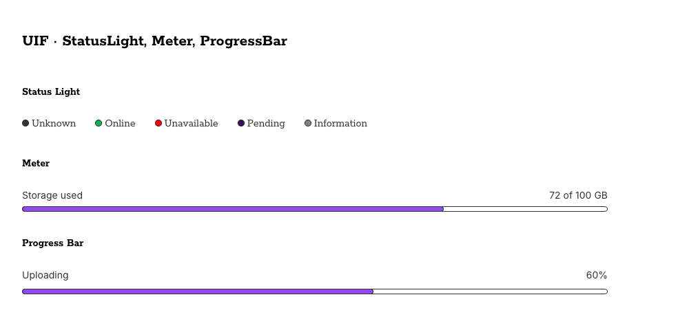
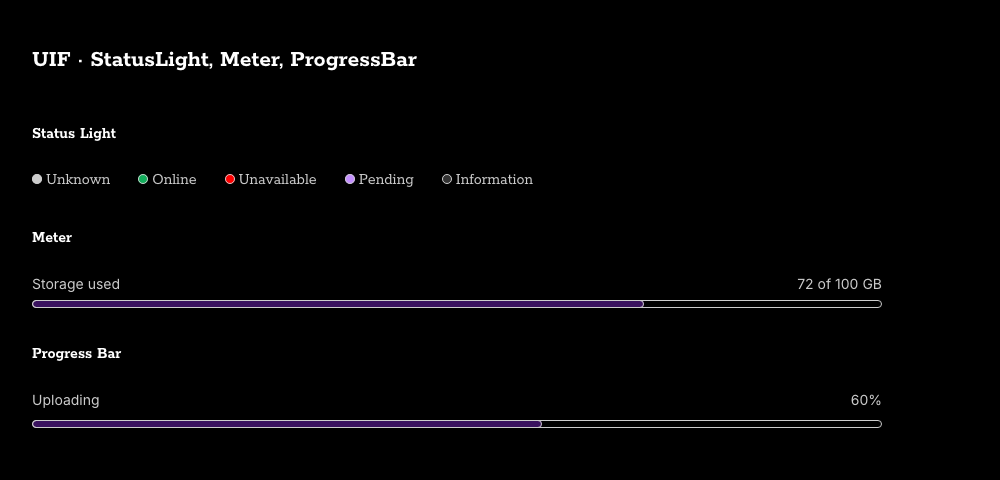

# StatusLight, Meter and ProgressBar reintegration

Scope: owner-requested first batch from the component-branch review on 2026-11-07. IMPLEMENT mode; only these three families and their integration/verification surfaces. Base: Runtime main `506807d037183154b420bd9f3f90a3e95a1b6d38`. Source: `feat/new-components-draft` at `357eb5fbb6deb434e74e8fbaae3bdc8715739c65` (#278). The remaining draft components are excluded.

## Boundary decision

StatusLight is a named condition with a decorative marker, distinct from Badge's compact category/count. Meter represents a scalar measurement with native meter semantics. ProgressBar represents completion of a task, including an indeterminate state. They have separate semantics and consumer APIs, so all three remain reusable pattern families rather than one generic colored-bar component.

## Token comparison and bounded adaptation

None of the 47 branch-owned slots existed on current main. `token-provenance.json` records every source value, historical variable ID and resulting Runtime value. Existing public slot names and numeric dimensions are retained; no Core, Appearance or Semantic tokens are introduced. The old aliases into Brand/Core/Appearance and sibling Typography are mapped to existing Semantics (Roles).

Live Figma inspection of the configured source file `3G6kkLVF0AKQO2BeCpixiN` was denied by the connected MCP service. The historical draft IDs must not masquerade as current source identity. Restored slots therefore omit unverified Figma IDs and alias metadata and are enumerated as code-only siblings in `figma/token-projection.json`. This uses the existing partial-sync preservation mechanism; it does not accept a new shared governance rule or assert Figma parity. Numeric dimensions are preserved historical Runtime values pending reconciliation.

The browser contrast check found insufficient legacy subtle text and status/track colors in some contexts. Bounded component adaptation: labels use semantic Content/Default; status color remains in the decorative dot; colored markers/fills receive an inward outline using semantic Content/Default and Size/Border/Default. Meter/ProgressBar tracks use Surface/Default with Border/Default outlining. This preserves the colored interior while giving its extent a discernible boundary. No shared color values were edited. Status remains communicated through text, not color alone.

CSS structural exceptions retained from the historical patterns: percentage-based geometry, circular dot radius, visually hidden native meter clipping, and the ProgressBar's 1.4s animation. These are not new canonical token slots. No animation token exists in the accepted semantic source; reduced-motion disables the animation. New transitions and magic color values were not added.

## Implementation

- Public CSS imports, Custom Element exports/subpaths, and TypeScript declarations.
- Native Meter measurement and aria-valuetext agree with the visible percentage/custom text; finite inputs are clamped and invalid ranges handled.
- ProgressBar preserves zero, clamps finite values and omits aria-valuenow/numeric text when indeterminate. Text uses DOM APIs rather than string interpolation.
- StatusLight preserves initial text through label overrides, attribute changes and reconnects; unknown variants fall back to neutral.
- Pure HTML Nunjucks macros remain usable without JavaScript; finite numeric arguments are the supported contract. Explicit escaping is used even when the host template disables autoescape.
- Playgrounds exercise the actual exported Custom Elements. Their HTML, Nunjucks and WC code output preserves the exposed controls and zero values. Docs build copies the exported element modules.

## Figma / Code Connect gate

The source mappings contained unverified or placeholder IDs (Meter `1-1`, ProgressBar `9001-1`, historical StatusLight `2385-709`). Their `.figma.ts` files now contain inactive examples, with no `figma.connect()` registration. Do not publish these examples as mappings or close design-parity issues until real nodes/properties are verified and connected. Live Figma parity and active Code Connect are **BLOCKED**; Runtime tests cannot satisfy this gate.

## Verification

Commands (Node 22.23.2):

```sh
npm run lint
npm run test:unit
CI=1 npm run ci:check
npm run pack:check
```

`ci:check` includes lint, unit tests, documentation/naming checks, build, smoke, token/usage/DTCG/asset/rule checks, docs build and headless Chromium tests. Focused browser coverage checks text/attribute lifecycles, native/visual Meter agreement, ProgressBar state and reduced-motion behavior, playground controls, and text/visible-boundary contrast in all six Brand/Scheme contexts. These checks do not certify complete accessibility or live Figma fidelity.

Final counts, checked source hash and gate results are recorded in `verification.json`. Local commands use the existing installed dependencies; GitHub CI uses a fresh lockfile install. This branch is for review; no main merge, version bump or publication is part of the task.

## Observed result

Runtime gate: **PASS** — 197 unit tests and 16 Chromium tests, plus package dry-run. After the full gate, only inactive TypeScript example typing and API documentation were adjusted; docs:lint and docs:build passed again. No Runtime behavior changed after that passing gate. Light/dark previews were visually inspected. Local startup on port 8117 exposed a pre-existing test that hardcodes port 8099; the final full command used the default port and passed.

Overall design acceptance: **BLOCKED** by live Figma access and inactive Code Connect mappings. These limits remain visible in the PR; no merge or release is claimed.





## Documentation completion

The first Runtime commit contained only abbreviated usage pages. The follow-up completes the established page format for all three components: hero controls/playground link, numbered anatomy, rendered options and sizes, API defaults, behaviors, usage guidance, content, keyboard behavior, accessibility, implementation examples, theming, tokens and an accurate design checklist. It also fixes a mobile options-table overflow using the existing table wrapper and gives the measurement previews full width.

After the documentation changes, `CI=1 npm run ci:check` passed again (197 unit tests, 16 Chromium tests). A separate rendered-page check verified all 11 sections, API rows, code examples, token tables, links and working hero switches at desktop/mobile sizes; no horizontal page overflow remains. Desktop/mobile screenshots were visually inspected. See `documentation-review.json`. Runtime behavior and the open Figma/Code Connect gate are unchanged.
